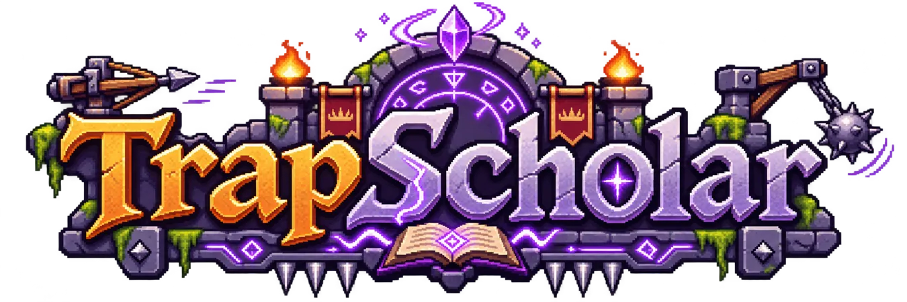
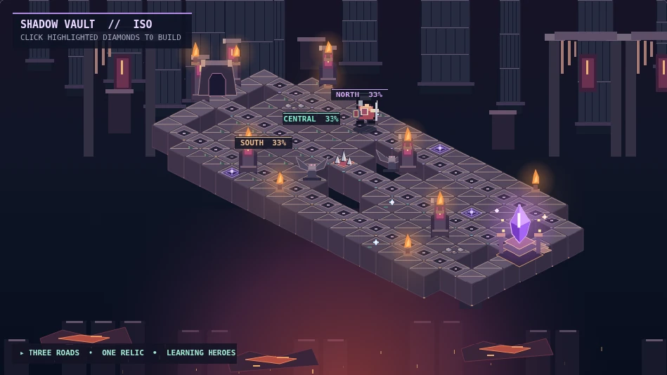
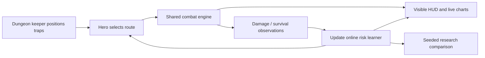
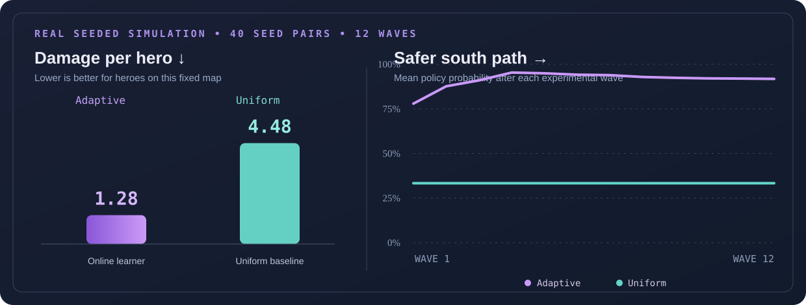
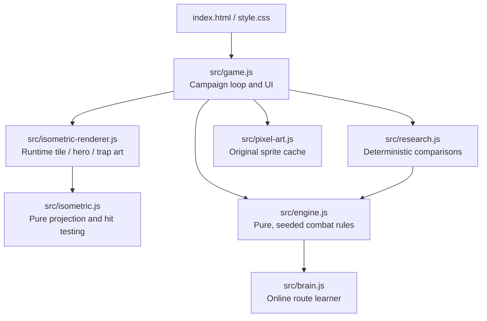

<div align="center">



### Build a dungeon. Teach the heroes to fear it.

**An offline, open-source isometric pixel strategy game with enemies that visibly learn from your defenses.**

    

[Play on Windows](#quick-start) · [Gameplay](#real-gameplay) · [Adaptive AI](#how-the-heroes-learn) · [Research mode](#research-mode) · [Development](#developer-notes)


<sub>Illustrated promotional key art. The images below show **real rendered gameplay**, not AI concept images.</sub>

</div>

---

## TrapScholar v2: Isometric Pixel Edition

You're the dungeon keeper defending a glowing relic. Place spikes, frost crystals, arcane turrets and venom traps across **three routes**. Raiders, scouts, guardians and arcanists learn which paths hurt them and gradually favor safer paths — so you must adapt your defenses in response.

**Version 2 adds a playable 2.5D isometric dungeon** while retaining the same deterministic combat and AI learning rules from v1.1. The renderer is original Canvas 2D code, not a heavyweight 3D engine, and it requires **zero runtime dependencies or GPU-specific downloads**. You can play completely offline after downloading the repository.

## Real gameplay

| Isometric dungeon | Trap placement and active raid |
|:--:|:--:|
|  |  |

*Captured from the actual game in headless Chromium using the local source modules. The surrounding image at the top is promotional artwork; the screenshots in this section show what is currently playable.*

**The visual conversion includes:**
- Projected diamond-shaped stone tiles, bridges, raised cliffs and lava chasms with hand-authored textures.
- A gothic entrance, glowing relic shrine, torchlight, banners, gargoyles, magic circles, stained-stone ruins and floor details.
- Four rendered isometric trap designs and animated hero class sprites, with health bars and hit effects.
- Real build interactions on rune sockets — no static background masquerading as a game.
- Pixel-accurate click-to-grid projection, high-DPI-friendly canvas scaling, mobile layout, and reduced-motion support.

**Scope note:** This is a functioning **2.5D/isometric** game, not a fully navigable 3D voxel world. The sophisticated illustrated cover is a design target, not a claim that runtime visuals have identical detail.

## Quick start

### Windows 10/11 PowerShell

```powershell
# Clone the project, or extract the downloadable source ZIP.
git clone https://github.com/Ikteder/TrapScholar.git
cd TrapScholar
.\scripts\start.ps1
# Open http://127.0.0.1:8080
```

If you already cloned v1.1, run `git pull` instead of cloning again.

### macOS / Linux

```bash
python3 -m http.server 8080 --bind 127.0.0.1
# Open http://127.0.0.1:8080
```

There is no `npm install` required to **play**. The game uses browser-native ES modules, so open it through a local static server rather than double-clicking the HTML file. Node.js 20+ is required only for tests, charts and seeded research fixtures.

### Controls

| Action | How |
|---|---|
| Select spike, frost, arcane, venom, remove | `1`, `2`, `3`, `4`, `5` or tool buttons |
| Build / replace / sell a trap | Click **glowing diamond sockets** during the build phase; decorative masonry is not interactive |
| Keyboard-only placement | Expand **Keyboard-only trap placement** and choose lane and tile |
| Start raid | `Space` or **Send the Heroes** |
| Pause / resume | `P` or Pause button |
| Accelerate simulation | Speed button: 1× → 2× → 4× |
| Enable optional sound | `M` / Sound button (off by default) |
| Save / restore | Export / import JSON, plus autosave between waves |
| Restart | Reset button (confirmation required) |

## How the heroes learn

Each hero faction maintains a damage-risk estimate for north, central and south. Outcomes update these per-lane estimates; a softmax-based decision policy then selects future routes with an exploration component. The probability bars are the model's **actual current probabilities**, not scripted story events.



The adaptive brain is in [`src/brain.js`](src/brain.js). Combat and the campaign are in [`src/engine.js`](src/engine.js). The research mode uses **the same combat rules**, not a separate approximate simulation.

### What the characters do

| Type | Behavior |
|---|---|
| Raider | Basic invading hero |
| Scout | Mitigates spikes |
| Guardian | Extra health and venom resistance |
| Arcanist | Mitigates arcane bolts |

Four traps have distinct damage / status behaviors. Three permanent upgrades can improve defenses; beat **15 waves** to win, or continue in endless mode.

## Research mode

The built-in laboratory compares **adaptive route selection** against **uniform route selection** under the same preset trap layout, with deterministic seeded runs. The lab replenishes relic wards between attempts to ensure both policies receive the intended number of trials. This differs intentionally from campaign survival, which ends when relic wards run out.



*Experimental example generated by the included engine code; this figure is not a promise of universal superiority. Seeds, layouts and caveats are documented in the example data.*

```powershell
npm test
npm run check
npm run benchmark
node scripts/plot.mjs
```

- [`data/example-experiment.json`](data/example-experiment.json) — complete reproducible JSON record
- [`data/example-experiment.csv`](data/example-experiment.csv) — exportable table
- [`assets/results-chart.svg`](assets/results-chart.svg) — generated visualization

**Limitations:** This is explainable, lightweight online statistical adaptation, not an LLM or deep reinforcement learning model. Paired seeds guarantee repeatability, but policies can consume random numbers differently. A small number of seeds does not establish statistical superiority. Read [`docs/ISOMETRIC_DESIGN.md`](docs/ISOMETRIC_DESIGN.md) for rendering, click selection and future art pipeline details.

## Architecture



| Component | Goal |
|---|---|
| `src/isometric.js` | Projection math, inverse coordinate picking, collision-safe build region |
| `src/isometric-renderer.js` | New isometric dungeon, platforms, lighting, traps, heroes and decorations |
| `src/game.js` | UI, campaign phases, animation, saves, audio and browser controls |
| `src/engine.js` + `src/brain.js` | Unchanged deterministic strategy rules / online learning |
| `tests/isometric.test.mjs` | Validate projection inversion and pointer selection |
| `scripts/browser_smoke.py` | Optional offline Chromium interaction smoke test |

## Verification

- **32 passing Node tests** in the packaged source, including exact projection inversion for all grid coordinates and behavior tests for the unchanged engine.
- Browser smoke test validated placing a spike trap through its projected diamond and launching a raid. No page-script exceptions were reported in the test harness.
- Images in **Real gameplay** were captured by that harness from the actual renderer. The synthetic research experiment is separately labeled.
- Windows native execution, long-play balancing, and real GitHub Pages deployment remain to be confirmed by project maintainers.

```bash
# Browser smoke test (optional; requires Python playwright and local Chromium)
python scripts/browser_smoke.py
```

### Host on GitHub Pages

This is a static browser project: after publishing the repo, enable **Settings → Pages → Deploy from a branch → main → /(root)**. GitHub Pages is optional; no server backend or hosted API is used.

## Next art milestones

Version 2 is a playable step toward the illustrated scene. Matching the illustrated key art **exactly** would take a coherent multi-angle sprite sheet pipeline, more unique animation frames, richer environmental tilesets, particles and lighting. See the continuation guide and design document; the current code intentionally avoids downloading third-party game assets without tracking licensing.

## Credits and licensing

Concept, implementation and project direction: **Ikteder Akhand Udoy** with AI-assisted development. Original project art and local Canvas graphics. Licensed under [MIT](LICENSE). See [CONTRIBUTING.md](CONTRIBUTING.md), [SECURITY.md](SECURITY.md), [AGENTS.md](AGENTS.md) and [LOCAL_AGENT_HANDOFF.md](LOCAL_AGENT_HANDOFF.md).
