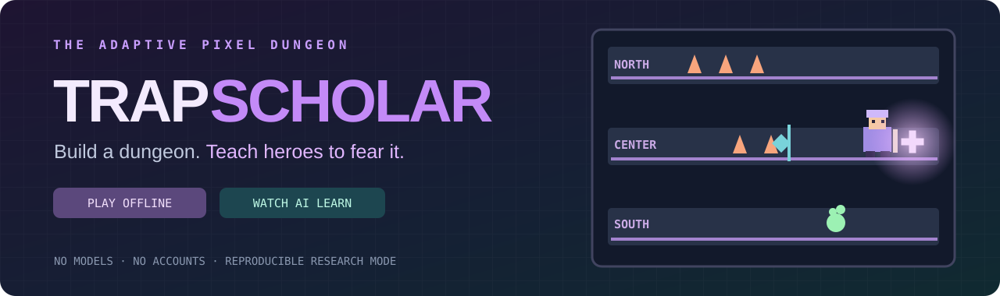
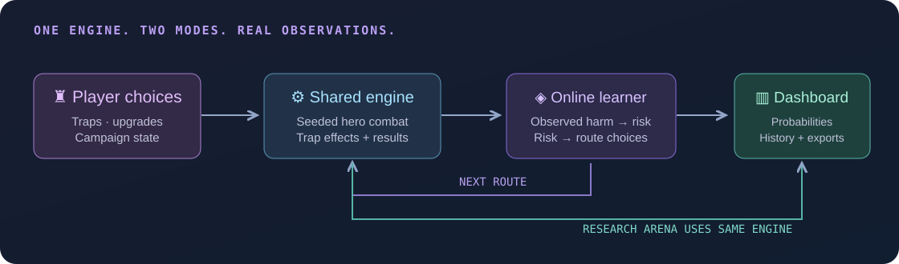

<div align="center">



<sub>Original vector art. Actual game screens are reproduced below.</sub>

## TrapScholar

### Build a dungeon. Teach heroes to fear it.

**A playable, offline pixel-art dungeon defense game where the *enemies learn from you*.**

[](LICENSE)


**[Play locally](#quick-start)** · **[Gameplay](#gameplay)** · **[See how the AI learns](#the-visible-ai)** · **[Reproduce the experiment](#reproducible-experiment)** · **[Architecture](#architecture)**

</div>

---

## What is TrapScholar?

Most tower-defense games give enemies a fixed route. **In TrapScholar, heroes remember what hurt them**. Put a deadly gauntlet in the north corridor and the hero faction gradually favors the south. Move your traps and their estimates can become outdated. The result is an ongoing strategic duel between your defenses and an observable, simple online learner.

You're the dungeon keeper. Protect your relic through **15 waves** of raiders, scouts, guardians, and arcanists. Every placement, kill, breach, and observation matters. Survive to claim victory, then optionally continue in endless mode.

This is a **complete playable small game**, not a slideshow, and **not a claim of state-of-the-art ML performance**. Gameplay sprites are drawn from cached hand-authored procedural pixel art, all gameplay and experiments run offline, and no neural networks, keys, models, APIs, tracking, or runtime package installs are needed.

<div align="center">

| **Dungeon building** | **Heroes in motion** |
|:---:|:---:|
|  |  |

*Actual Chromium interactions rendered by the v1.1 browser game code, not concept art or mock-ups. The cover above is separately labeled promotional artwork.*

</div>

### New in v1.1 — pixel-art overhaul

The gameplay canvas now renders **authored 32×32 pixel sprites**, rather than the original minimal rectangles. The new art includes beveled stone floor tiles, gothic masonry with moss and cracks, illuminated gates, a glowing relic, colorful trap sprites, animated character class silhouettes, banners and torchlight. The sprite cache is painted locally using Canvas 2D — **zero image downloads required for gameplay**. Reduced-motion preferences are respected.

The downloadable full-art edition also includes optional high-resolution **promotional pixel key art and an illustrated logo**. The lightweight GitHub edition uses the self-contained SVG cover to stay easy to fork and deploy. Those are *artwork*, not screenshots and not evidence of an isometric game engine. The game itself remains top-down, and the benchmark/chart values have not been changed by the graphics work.

#### What it looks like on a desktop


### At a glance

| Playable strategy | Inspectable AI | Research-grade habits | Open-source friendly |
|---|---|---|---|
| 4 trap types, 4 hero classes, permanent upgrades, 15-wave victory + endless | Per-route danger estimates, exploration bonus, live route-probability bars | Seeded RNG, explicit simulator assumptions, CSV/JSON data, unit + browser-interaction checks | No build step, no cloud, no third-party art, GitHub Pages compatible |

## Quick start

**Requirements:** any modern Chromium/Firefox/Safari browser and a static file server. Python 3 is convenient but not required. Node.js 20+ is **only for tests and reproducible experiments**.

**Windows 11 / PowerShell:**

```powershell
# Inside the extracted trapscholar project folder
.\scripts\start.ps1
# Open http://127.0.0.1:8080
```

**macOS / Linux:**

```bash
python3 -m http.server 8080 --bind 127.0.0.1
# Open http://127.0.0.1:8080
```

**Alternative (if Node.js is already available):**

```bash
npx --yes http-server . -a 127.0.0.1 -p 8080
```

The Node alternative downloads a package if it isn't cached; the Python route does not. **Opening `index.html` directly with `file://` is not supported**, because browser security policies restrict JavaScript module imports. Host it locally or via GitHub Pages.

### Controls

| Action | Control |
|---|---|
| Select spikes, frost, arcane bolt, venom, remove | `1` `2` `3` `4` `5` or click the buttons |
| Place/replace/remove a trap | Click or tap a corridor tile while building |
| Keyboard-only trap placement | Expand **Keyboard-only trap placement**, choose lane/tile |
| Start the next wave | `Space` or **Send the heroes** |
| Pause / resume | `P` or **Pause** |
| Change animation speed | **Speed 1× / 2× / 4×** |
| Toggle synthesized sound | `M` or **Sound** (off by default) |
| Export / import campaign | **Export save** / **Import save** (JSON) |
| Reset | **Reset run** (asks for confirmation) |

## Gameplay

<details open>
<summary><b>Your dungeon arsenal</b></summary>

| Trap | Cost | Damage / effect | Design intent |
|---|---:|---|---|
| ▲ Spikes | 2 souls | 2 immediate damage | Cheap, reliable; scouts counter it |
| ❄ Frost | 3 souls | 1 hit + 2 lingering damage ticks, slows hero | Slows progress while dealing lingering damage |
| ✦ Arcane bolt | 4 souls | 3 immediate damage | High burst; arcanists resist it |
| ☣ Venom coil | 5 souls | 1 hit + 3 lingering damage ticks | Attrition; guardians resist poison ticks |

The hero army also develops **resistance to the trap type responsible for the most accumulated damage**, starting on wave 4 once enough damage has been observed. Diversifying is often stronger than spamming one trap.

</details>

<details>
<summary><b>Four heroes, three dungeon upgrades</b></summary>

**Invaders:** Raiders (all-rounders), Scouts (reduced spike damage), Guardians (+3 HP and poison resistance), and Arcanists (reduced arcane-bolt damage). Roles enter the roster progressively.

**Keeper upgrades:** Reinforce wards (9 souls, restore +3 wards up to 16), Soulforge (10 souls, earn +1 soul per kill), and Overcharge (12 souls, +1 base spike / bolt damage). Soulforge and Overcharge are permanent for the current run.

You start with **18 souls and 12 wards**. Each completed wave awards +4 souls; defeated heroes award +2 souls, or +3 with Soulforge. At 0 wards, the relic falls. At the end of wave 15, any remaining ward unlocks a victory and an optional endless continuation.

</details>

<details>
<summary><b>Accessibility, saves, audio and responsive play</b></summary>

The UI has keyboard navigation, a keyboard-only placement form, focus outlines, responsive mobile layout, labels and reduced-motion support. The game uses cached, authored 32×32 pixel sprites painted into a standard 2D canvas, with hit bursts, damage numbers, two walking poses per hero class, status effects and health indicators.

Save snapshots automatically at **stable build and completed-wave states**. Reloading during a raid returns to the previous stable snapshot. The JSON importer validates file size and schema. v0.1 browser saves are migrated in a non-destructive manner. Sound uses native Web Audio oscillators and is **opt-in**, with no audio files to install.

</details>

## The visible AI

There is no black-box LLM deciding routes. The learner is a deliberately modest, inspectable **risk-aware, nonstationary three-armed bandit heuristic**. Each route holds a visit count, estimated harm and observed outcomes.

A hero chooses among three paths using a seeded random sample from softmax probabilities. After the outcome, the learner updates **only the visited route** with its *experienced damage and survival*. It does **not** read trap locations on unvisited corridors.

For lane \(i\), on observing damage \(d\) and whether a hero survived the route, the heuristic applies:

```text
sample = damage - 0.4 if survived, else damage + 0.6
riskᵢ ← max(0, sample)                         [first observed visit]
riskᵢ ← max(0, 0.55 × riskᵢ + 0.45 × sample)   [later visits]

scoreᵢ = riskᵢ − 1.8 √(ln(total_visits + 2) / (visitsᵢ + 1))
P(lane i) = softmax(−scoreᵢ / 0.9)
```

The exploration term favors less-visited routes; an exponential moving average lets the model respond to layout changes. It is **not Q-learning, deep reinforcement learning, gradient-based training or a proven optimal bandit algorithm**. Policy logic lives in [`src/brain.js`](src/brain.js), while gameplay rules live in [`src/engine.js`](src/engine.js).

<div align="center">



</div>

## Reproducible experiment

> **Real synthetic test, not fabricated model measurements.** The sample below was produced by the actual TrapScholar engine at **seed 2026, 40 seed pairs, 12 waves each**. It measures the game's tiny *adaptive route policy*, **not** an LLM, novel research contribution or a statistical guarantee.


### What exactly is being compared?

**Scenario:** one fixed trap layout. North has four heavy traps; Central has spikes and frost; South has one light spike trap. A policy may choose routes based on a continuously updated learner (**adaptive**) or select from an equal 1/3 chance for each lane (**uniform baseline**). Both policies use identical combat rules and independent, deterministic pseudo-random streams initialized from the same paired seeds. Since different choices consume RNG differently, these are reproducible paired seeds **not** matched counterfactual trajectories.

**Laboratory difference from the campaign:** The arena **replenishes wards before each hero attempt**, so an early relic defeat cannot truncate learning. Each policy receives an equal number of attempted hero runs (42 per 12-wave trial), and each hero uses the same damage, status effects and memory-update functions as the campaign. Research results are conditional on this **one** scenario, and should not be generalized to other environments without further experiments.

| Actual sample statistic | Adaptive | Uniform |
|---|---:|---:|
| Mean damage per hero | **1.28** | 4.48 |
| Hero survival rate | 97.2% | 84.6% |
| Share choosing South (safer) | 88.4% | 33.3% |
| Sample SD of per-seed mean damage | 0.17 | 0.38 |

The adaptive heroes learn to avoid costly lanes and are **more likely** to reach the relic. **That is bad for the dungeon keeper, but good for the learning policy.** The behavior is scenario-dependent. The project makes no claim that the heuristic is superior across games, seeds, or alternative reward formulations.

### Reproduce exactly

```bash
npm test
npm run benchmark    # seed 2026 · 40 seed pairs · 12 waves
node scripts/plot.mjs
```

This regenerates [`data/example-experiment.json`](data/example-experiment.json), [`data/example-experiment.csv`](data/example-experiment.csv), and [`assets/results-chart.svg`](assets/results-chart.svg) — all calculated from code, with no external API. Run the **Research mode** section in the browser to change the number of seed pairs and waves, compare results, inspect every run, and export its CSV.

The full per-seed observations are deliberately shipped alongside the visualization; anyone can audit the exact figures.

<details>
<summary><b>See the actual in-game research dashboard</b></summary>


</details>

### Research limitations

- A toy **three-route** decision problem; no high-dimensional RL, neural network, or image understanding.
- A fixed example map, intentionally asymmetric and not randomized per trial. The safe choice is easy to learn in this scenario.
- Per-seed standard deviations describe *variation across these seeds*, **not** formal confidence intervals or proof of significance.
- Policies consume different numbers of PRNG draws. A stronger causal comparison would separate the randomness driving environment events from policy sampling and use more scenario diversity.
- The player can change traps between waves, making the deployed game nonstationary. The example laboratory freezes the map to isolate route adaptation.

## Architecture

```text
trapscholar/
├─ index.html                  # Accessible game UI + experimental laboratory
├─ style.css                   # Responsive, dark pixel-game dashboard
├─ src/
│  ├─ brain.js                 # Risk estimates, softmax, exploration, observations
│  ├─ engine.js                # Deterministic combat, economy, heroes, upgrades
│  ├─ game.js                  # UI, audio, saves, animation and gameplay rendering
│  ├─ pixel-art.js             # Cached 32×32 artwork, trap/hero variants, tile rendering
│  └─ research.js              # Fixed-layout, continuous seeded research arena
├─ tests/
│  ├─ brain.test.mjs           # AI probability and observation tests
│  ├─ engine.test.mjs          # Trap effects, save schema, deterministic live/batch parity
│  └─ research.test.mjs        # Seed matching, complete experimental data, CSV
├─ data/
│  ├─ example-experiment.json  # Real generated deterministic runs
│  └─ example-experiment.csv
├─ assets/
│  ├─ gameplay-pixel-v1.1.svg  # Trace of a real pixel-game screenshot
│  ├─ raid-pixel-v1.1.svg      # Trace of a real raid screenshot
│  ├─ cover.svg                # Original vector cover
│  ├─ results-chart.svg        # Chart derived from the actual experiment
│  ├─ architecture.svg         # Reproducibility diagram
│  └─ ...                      # Genuine Chromium screenshots, favicon
├─ scripts/
│  ├─ start.ps1                # Local Windows web server
│  ├─ test.ps1                 # Offline tests on Windows
│  ├─ benchmark.mjs           # Regenerate sample data
│  └─ plot.mjs                # Regenerate SVG from sample data
├─ .github/workflows/tests.yml
├─ LICENSE                    # MIT
├─ CONTRIBUTING.md
├─ CHANGELOG.md
├─ VERIFICATION.md
├─ SECURITY.md
└─ LOCAL_AGENT_HANDOFF.md     # For a local coding LLM to continue if desired
```

### Engineering invariants

1. **One rule source:** game animation and batch experiments call the same `makeHero`, `stepHero`, and `finishHero` functions. The experiment explicitly documents its different ward-reset rule.
2. **Inspectable choices:** the learner's state, estimated danger, probabilities and actual outcomes are visible/exportable.
3. **Reproducible core:** xorshift32 seeded randomness; deterministic JavaScript combat and experiments. Browser animation timing and timestamps are intentionally not deterministic.
4. **Visual independence:** pixel sprites are generated/cached with Canvas 2D at runtime, separate from combat rules; the cover and logo are decorative assets only.
5. **Safe untrusted input:** JSON import is bounded and validated; user messages in the event log are rendered via `textContent`, never executed as markup. No model/API secrets are used.
6. **Lightweight by default:** no runtime libraries, no build pipeline, no analytics, no network requests. Tests use Node's built-in test runner.

## Verification

See also the detailed [release verification report](VERIFICATION.md).

| Check | Result |
|---|---|
| Node 22 unit tests | **26 passed** |
| JavaScript syntax checks | Passed |
| Chromium interaction harness | Trap placement, spending, pause, wave completion, graph updates, experiment, CSV export, valid-save import and reset passed |
| Responsive browser check | 390 px mobile viewport, no horizontal overflow in harness |
| Browser victory and endless transition | Wave-15 clear and Continue Endless button both passed |
| Browser script errors | None observed in the harness |
| Native Windows 11 / Edge execution | **Not yet verified on the target computer** |

Browser tests used an **inline-module harness** because the execution environment blocked direct localhost navigation. This does **not** replace a real static-server smoke test in Windows. The screenshots are from rendered browser interactions, not illustrations passed off as screenshots.

### GitHub Pages (optional)

Publish a static copy without needing a server. In the new repository open **Settings → Pages → Build and deployment → Deploy from a branch → `main` → `/ (root)`**. The game uses relative asset paths and does not require server-side code. Your actual Pages URL depends on your repository owner and its published settings.

## What to improve next

- [x] Fully playable 15-wave campaign and endless continuation
- [x] Four enemy archetypes, four traps, three upgrades, visual hit effects and opt-in sound
- [x] Deterministic shared engine with unit tests and seeded experiment runner
- [x] Campaign learning curves, transparent probabilities, exports and validated imports
- [x] Responsive layout and keyboard-only placement option
- [ ] More tactical hero behaviors (scouting, shields, branching movement and pathfinding)
- [ ] Larger procedural arenas, multiple relic stages and more varied boss encounters
- [ ] Better art animation, accessibility audit with screen readers, cross-browser mobile testing
- [ ] Advanced research suite with varied scenarios, confidence intervals and fairer RNG pairing
- [ ] Optional local LLM **dialogue only**, with the game still fully usable with it off
- [ ] Independent Windows/Edge deployment verification and user playtesting

## Credits, licensing and contributing

TrapScholar's procedural game art, vector diagrams, audio oscillator effects and code are original to this project and distributed under **MIT**. **No third-party sprite packs, copyrighted game graphics, assets, models or audio clips are bundled.**

The general idea belongs to the broad family of risk-aware online exploration methods and dungeon defense games. Relevant inspiration: [Kenney Tiny Dungeon](https://kenney.nl/assets/tiny-dungeon) (a potential external CC0 sprite source, **not currently bundled**) and open-source adaptive game agents. These projects have not reviewed or endorsed TrapScholar.

See [CONTRIBUTING.md](CONTRIBUTING.md), [SECURITY.md](SECURITY.md), [CHANGELOG.md](CHANGELOG.md) and [LOCAL_AGENT_HANDOFF.md](LOCAL_AGENT_HANDOFF.md). Bug reports, design experiments and reproducibility fixes are welcome.

---

<div align="center">

**The dungeon changes its defenses. The heroes change their minds.**

*TrapScholar · An offline game about adaptation, feedback and imperfect knowledge.*

</div>