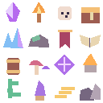
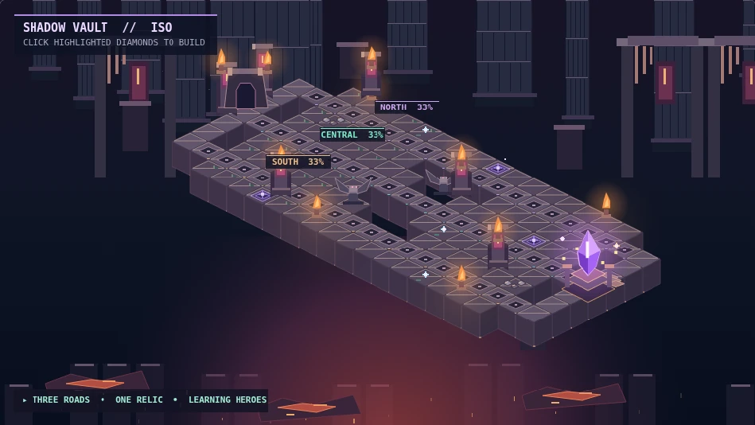
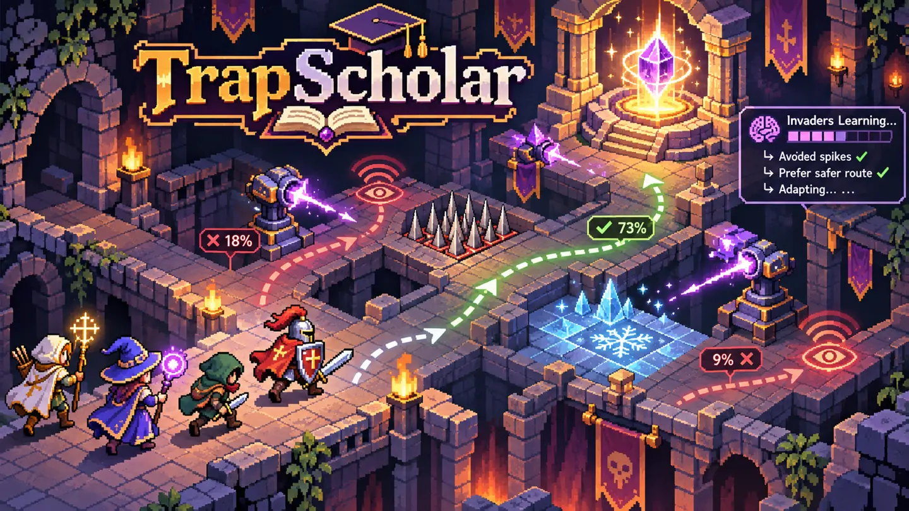
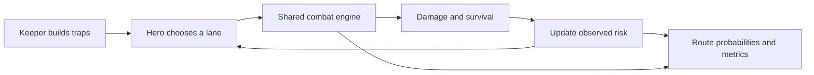
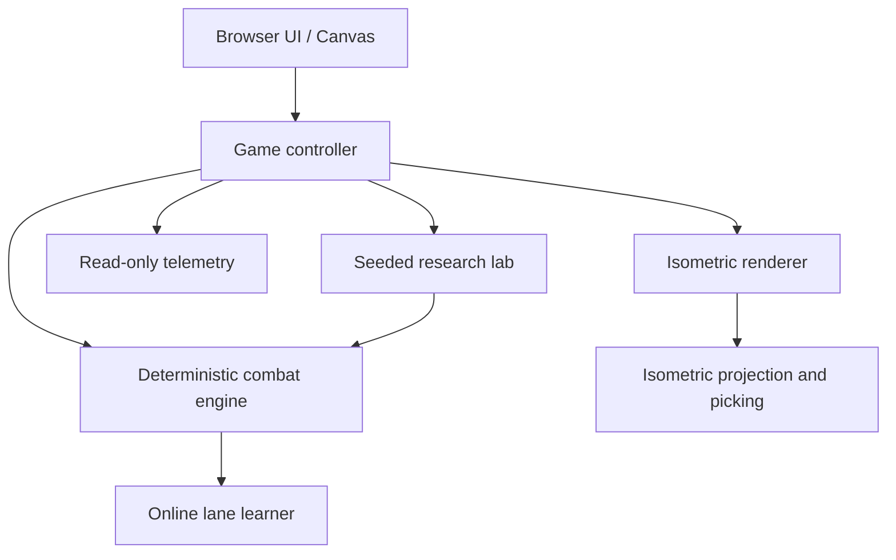

<div align="center">

# TrapScholar

**Build a dungeon. Watch the heroes learn. Outsmart their next move.**

An offline, isometric pixel-art strategy game with transparent adaptive enemies and a reproducible AI sandbox.

[](https://github.com/Ikteder/TrapScholar/actions/workflows/tests.yml)


[Play locally](#play-in-under-a-minute) · [Screenshots](#the-playable-game) · [Live metrics](#meaningful-game-metrics) · [Research](#reproducible-experiments) · [Architecture](#architecture)

</div>

<p align="center">
  
</p>

<p align="center"><sub>Actual game rendering in Chromium. No generated concept art is represented as gameplay.</sub></p>

> **Release v3.0:** The playable dungeon now uses clearer three-lane geometry, atmospheric torch and chasm lighting, and a small original sprite atlas. The AI, campaign and save format remain compatible. Gameplay screenshots below document the preceding v2.1 baseline; run the game to see the current v3 visuals.

## Why play it?

You're the final boss defending a glowing relic. Build a trap network across **three branching routes**. Every invading hero generates an observation: the route they took, damage they received, and whether they survived. Their faction then updates its beliefs and changes its route-selection probabilities. If you over-defend one corridor, the heroes may learn to avoid it.

| What you control | What the heroes do |
|---|---|
| Place four traps on glowing sockets | Choose north, central, or south routes |
| Upgrade the dungeon between waves | Estimate risk from their own observed damage |
| Manage souls and relic wards | Continue exploring instead of always taking the same lane |
| Survive 15 waves, then optionally continue forever | Adapt their route probabilities to changing defenses |

No account, API key, cloud service, or LLM download is needed. **The actual learning algorithm is a small, interpretable online statistical policy**, not a language model or deep reinforcement-learning agent.

## Play in under a minute

**Windows 10/11 · PowerShell**

```powershell
git clone https://github.com/Ikteder/TrapScholar.git
cd TrapScholar
.\scripts\start.ps1
```

**macOS / Linux**

```bash
git clone https://github.com/Ikteder/TrapScholar.git
cd TrapScholar
python3 -m http.server 8080 --bind 127.0.0.1
```

Open **http://127.0.0.1:8080**. The project uses browser-native JavaScript modules. A local static server is required; there is **no npm install to play**. Node.js 20+ is only needed for development tests and benchmark regeneration.

**Controls:** Select a trap with `1`–`4`, remove with `5`, click a glowing isometric socket to build, press `Space` to start a raid, `P` to pause, and `M` to toggle optional sound. Use **RISK OVERLAY** to reveal the AI's estimated route danger on the floor. Keyboard-only build controls, autosave, save import/export, speed controls, and reduced-motion support are also provided.

## V3: atmospheric graphics and source-aware assets

V3 adds a **working** asset-backed isometric environment: a 16-sprite original SVG atlas, moss and dungeon objects on non-interactive masonry, brighter torches, subtle dust, deeper masonry shadows and a less cluttered raid view. The game needs no internet connection. This is still 2.5D Canvas, not real-time 3D.

<p align="center"></p>
<p align="center"><sub>Original v3 project prop atlas, not an external dataset image.</sub></p>

### The two Hugging Face sources evaluated

| Dataset | Practical role | License and limitation |
|---|---|---|
| [Angais Pixel Art Atlas 1.4M](https://huggingface.co/datasets/Angais/pixel-art-atlas-1.4m) | 16×16 objects and icons; *not* coherent isometric world/hero animations | CC0 only to the author's rights; Krea and third-party terms remain |
| [NVIDIA SimReady](https://huggingface.co/datasets/nvidia/simready-assets) | Selective OpenUSD 3D reference/baking; *not* a lightweight fantasy tileset | Listed CC BY 4.0; 2,677 assets, ~490GB total |

The datasets are **not bundled**. An optional Pixel Art Atlas preview/import script is provided for manual quality and rights review. For coherent dungeons, prefer [Kenney Isometric Dungeon Tiles (CC0)](https://kenney-assets.itch.io/isometric-dungeon-tiles) or [KayKit Dungeon Pack (CC0)](https://kaylousberg.itch.io/kaykit-dungeon-pack), with an offline fixed-camera render-to-sprite pipeline.

See [ASSET_PIPELINE](docs/ASSET_PIPELINE.md) and [THIRD_PARTY_ASSETS](THIRD_PARTY_ASSETS.md). Do not imply the illustrated fantasy cover is gameplay.

## The playable game

### Build your defenses

<p align="center"></p>

<p align="center"><sub>Build phase · raised stone bridges, rune sockets, a gothic entrance, and the relic shrine.</sub></p>

### Start a raid

<p align="center"></p>

<p align="center"><sub>Raid phase · hero class sprites, animated combat, trap effects, and route-probability signs.</sub></p>

**About the visuals:** This is a working **2.5D Canvas renderer**, not a freely navigable 3D world. The in-game art is hand-authored programmatic pixel art. The illustrated cover in the expandable section below is promotional concept art showing a richer long-term visual target.

<details>
<summary><b>Show promotional artwork (not gameplay)</b></summary>

<p align="center"></p>

<p align="center"><sub>Concept art only. Do not use as evidence of current real-time graphics.</sub></p>
</details>

## Meaningful game metrics

The right-hand **Hero intelligence** panel contains three new telemetry cards. They are derived from the current campaign state and update as combat resolves.

| Metric | Definition | What it tells you |
|---|---|---|
| **Defense rate** | Heroes stopped ÷ all resolved hero attempts | How effectively your dungeon has defended across the run |
| **Damage / hero** | Total observed trap damage ÷ resolved hero attempts | Average damage the actual trap engine dealt, including damage over time |
| **Route focus** | `100 × (1 − H(p) / ln 3)` where `H(p) = −Σ pᵢ ln pᵢ` | How concentrated the hero route policy is: 0% uniform, 100% concentrated on one route |

Defense rate and damage per hero show `—` before any hero has finished a run; **we never substitute fake zeroes for missing observations**. Route focus measures policy concentration, **not intelligence, accuracy, or ability to win**. The optional colored risk overlay shows **estimated danger learned by heroes**, not privileged access to your trap layout.

The accompanying line graph records **actual post-wave probabilities** for north, central, and south. It is not scripted or sampled from the example research chart below.


## How the AI works



The learner keeps a recent-risk estimate for each lane and updates it from the hero's observed outcome. A softmax-like policy balances risk avoidance with exploration. The **same** [`src/engine.js`](src/engine.js) drives the live game and the offline lab. The policy lives in [`src/brain.js`](src/brain.js); telemetry calculations are isolated in [`src/metrics.js`](src/metrics.js).

### Classes, traps, and progression

| Invader | Trait | Defensive options |
|---|---|---|
| Raider | Standard health and defenses | Spike pit · Frost rune |
| Scout | Reduced spike damage | Arcane bolt · Venom coil |
| Guardian | More health, venom resistance | Overcharge · Focused defenses |
| Arcanist | Reduced bolt damage | Spikes · Frost rune |

Defeat heroes to earn souls, reinforce your relic wards, acquire permanent upgrades, and survive the 15-wave campaign. Endless mode becomes available afterward.

## Reproducible experiments

The built-in lab evaluates adaptive-route versus uniform-route policies on a **fixed synthetic trap layout** with seeded experiments. It restores relic wards between experimental attempts so both policies complete an equal number of trials; **this is an evaluation arena, not the standard campaign rules**.

<p align="center"></p>

<p align="center"><sub>Example generated from committed synthetic experiment data—not fabricated gameplay telemetry or a general performance guarantee.</sub></p>

The lab reports per-policy damage and survival, route-choice shares, and the **uniform − adaptive** mean damage difference. Version 2.1 also reports an approximate 95% seed-level interval where multiple seed comparisons exist. **Important:** even matching seed numbers do not produce matched random streams for the two policies, so the interval is descriptive; it is not evidence of a causal treatment effect or statistically proven superiority.

```bash
npm test           # deterministic rules, learner, telemetry, projections, research
npm run check      # syntax validation plus tests
npm run benchmark  # regenerate the example research JSON and CSV
node scripts/plot.mjs  # rebuild the SVG directly from saved experiment data
```

Reproducibility files: [`data/example-experiment.json`](data/example-experiment.json) · [`data/example-experiment.csv`](data/example-experiment.csv) · [`src/research.js`](src/research.js).

## Architecture



| Source | Responsibility |
|---|---|
| [`src/game.js`](src/game.js) | Browser interactions, campaign loop, saves, combat animations |
| [`src/isometric-renderer.js`](src/isometric-renderer.js) | Runtime art, platforms, characters, traps, optional risk overlay |
| [`src/isometric.js`](src/isometric.js) | Tile projection and click hit-testing |
| [`src/engine.js`](src/engine.js) | Combat, souls, wards, upgrades, progression |
| [`src/brain.js`](src/brain.js) | Observed lane-risk estimation and route selection |
| [`src/metrics.js`](src/metrics.js) | Tested campaign analytics, entropy-based route focus |
| [`src/research.js`](src/research.js) | Seeded policy comparison and exports |

## Project status and limitations

- Fully offline, source-available, browser-playable game with no commercial dependencies.
- Deterministic model-free core with automated tests. See [`VERIFICATION.md`](VERIFICATION.md) for reproducible verification and outstanding platform checks.
- Isometric artwork is intentionally stylized and simpler than the promotional illustration. This project does not currently use a voxel engine or externally sourced character sprite sheets.
- The learner is designed to be **explainable and fun**, not presented as a publication-grade reinforcement-learning benchmark. Seed-level comparison uncertainty should be interpreted cautiously.
- The current saves use the `save-v2` format for compatibility; visual and telemetry updates do not change the combat schema.

### Future milestones

Higher-fidelity multi-frame hero sprites, advanced spell VFX, environmental animations, animated route heatmaps, richer enemy squads, replayable combat traces, and formal multi-seed experiment reporting. Check [`LOCAL_AGENT_HANDOFF.md`](LOCAL_AGENT_HANDOFF.md) for the local-coding-agent continuation plan and [`docs/ISOMETRIC_DESIGN.md`](docs/ISOMETRIC_DESIGN.md) for art constraints.

## Contributing and license

TrapScholar is available under the [MIT License](LICENSE). Contributions, bug reports, art assets with clear provenance, and reproducible research improvements are welcome. Read [CONTRIBUTING.md](CONTRIBUTING.md), [SECURITY.md](SECURITY.md), and [AGENTS.md](AGENTS.md).

**Project direction:** Ikteder Akhand Udoy · AI-assisted implementation and visual development.